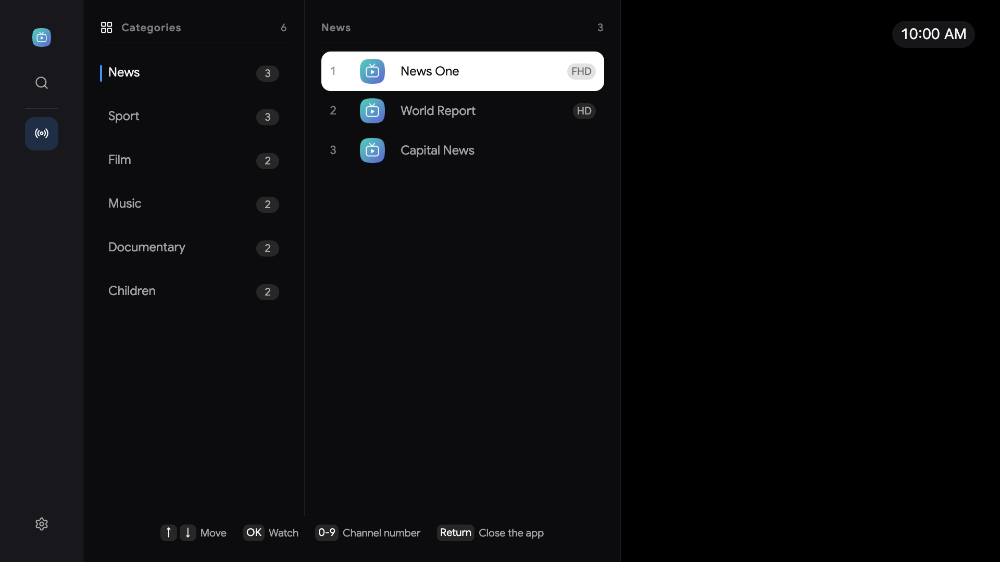
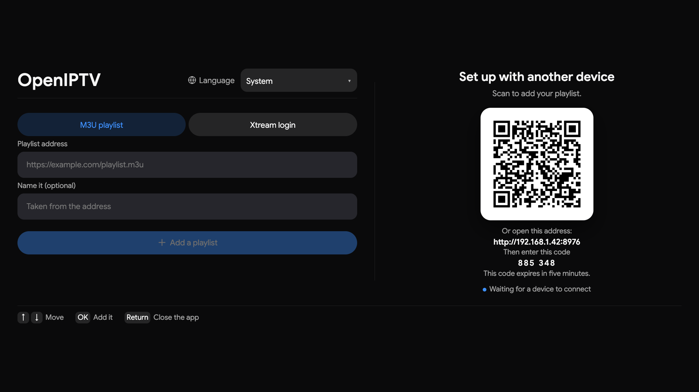
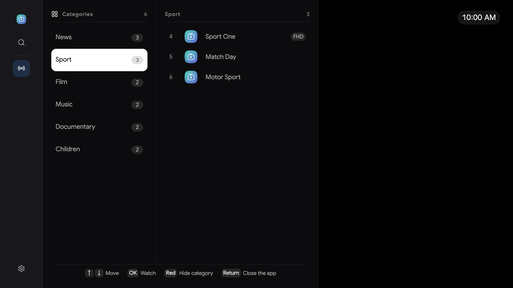
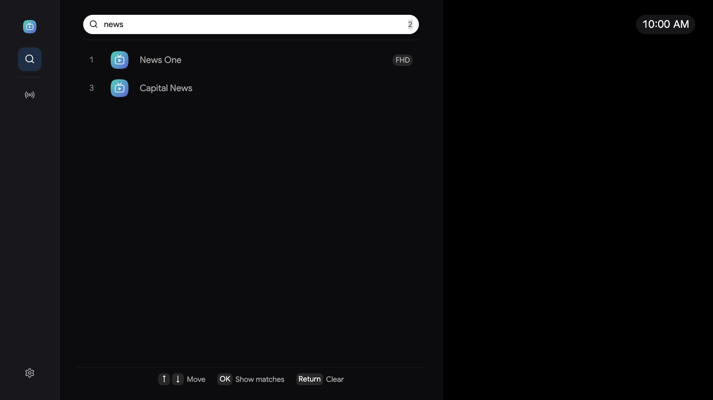
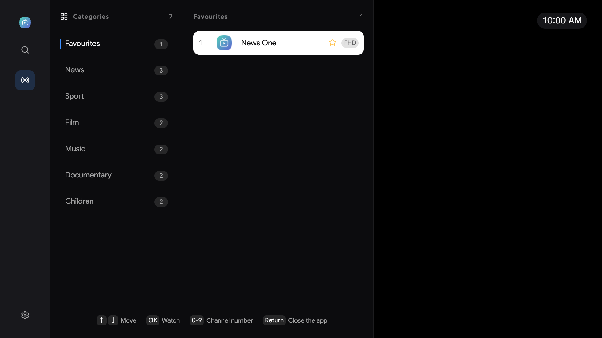
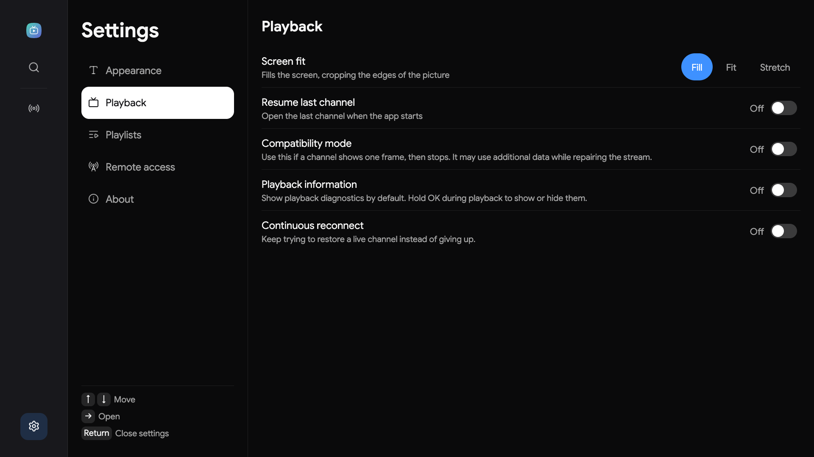
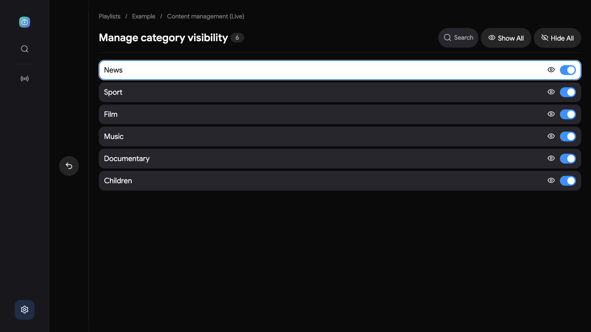
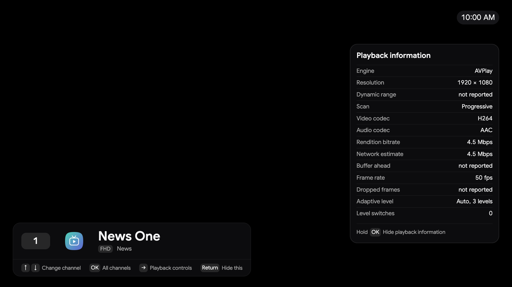
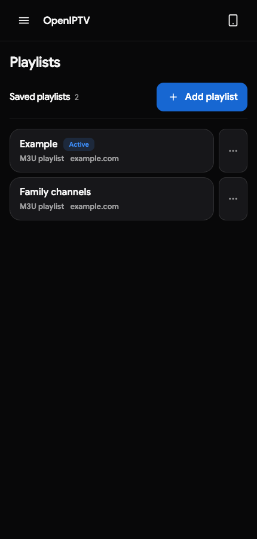
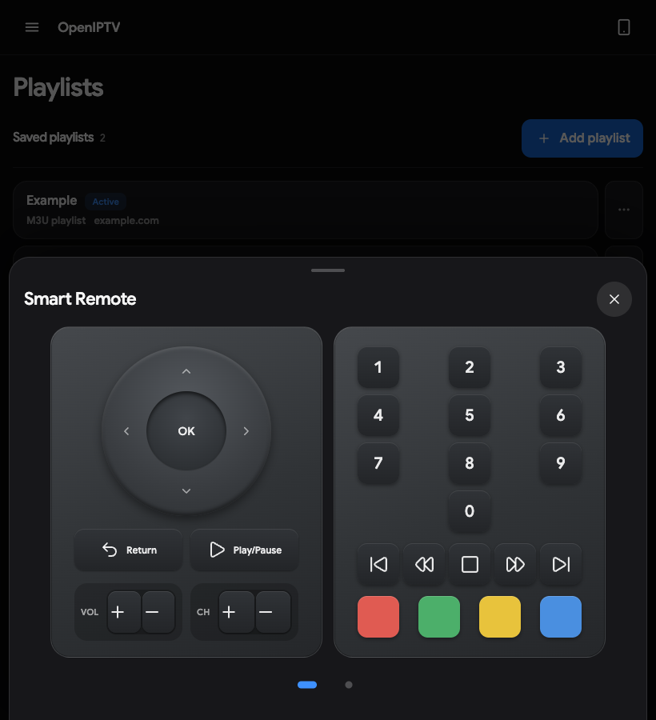

#  OpenIPTV

[](https://github.com/shayanline/OpenIPTV/actions/workflows/ci.yml)
[](https://github.com/shayanline/OpenIPTV/releases/latest)
[](https://github.com/shayanline/OpenIPTV/releases)
[](LICENSE)
[](https://developer.samsung.com/smarttv/develop/specifications/tv-model-groups.html)

OpenIPTV is an open source IPTV player for Samsung Tizen TVs. Add an [extended M3U playlist](#add-playlists) to watch live channels, or connect an Xtream account to browse the live TV, movies and series your provider offers.

Use your TV remote to browse, search and organise channels. You can also [pair a phone or tablet](#remote-access) on the same local network to manage playlists and control playback.

Your playlists, preferences and favourites stay on your device. No OpenIPTV account is required, and the app has no advertising, analytics or project operated service.

> [!TIP]
> [Try OpenIPTV in your browser](https://shayanline.github.io/OpenIPTV) using the arrow keys and Enter as the directional pad and OK button. To try a sample, copy the address of the [demo playlist](https://shayanline.github.io/OpenIPTV/demo/nasa.m3u) into the playlist field. Some providers work only in the TV app because of [browser limitations](#browser-limitations).

> [!IMPORTANT]
> OpenIPTV includes no channels, subscriptions or other content. You provide your own playlist or provider account and must have the right to access that content. The project is not affiliated with any broadcaster, channel, streaming service or playlist provider.

## See OpenIPTV

### On the television

[](docs/screenshots/02-channels.png)

<details>
<summary>Setup, search, favourites and settings screenshots</summary>

|  |  |
|:--|:--|
| [](docs/screenshots/01-first-run.png) | [](docs/screenshots/03-categories.png) |
| [Set up a playlist](#add-playlists) | Browse playlist categories. |
| [](docs/screenshots/04-search.png) | [](docs/screenshots/05-favourites.png) |
| Search channels. | Save favourites. |
| [](docs/screenshots/06-settings.png) | [](docs/screenshots/07-category-management.png) |
| Change playback settings. | Manage playlist categories. |
| [](docs/screenshots/08-playback-information.png) |  |
| View playback information. |  |

</details>

### Remote access on a phone

<details>
<summary>Phone management and Smart Remote screenshots</summary>

|  |  |
|:--:|:--:|
| [](docs/screenshots/09-remote-access.png) | [](docs/screenshots/10-smart-remote.png) |
| [Manage OpenIPTV from another device](#remote-access) | [Use the Smart Remote](#remote-button-reference) |

</details>

## What you can do

- Watch live TV, movies, series and episodes from your Xtream provider, including programme information and catchup when available.
- Search every live channel, tune using the channel numbers shown in the list, and save favourites.
- Browse the original playlist categories, rename or number channels, hide items and change their order.
- Continue movies and episodes from saved progress through Continue watching or Favourites, and resume the last channel or video.
- Pause movies, episodes and catchup, or seek in ten second steps. The playback controls also provide the Guide, audio tracks, subtitles, diagnostics and transport controls.
- Use the TV or a paired phone to manage the same saved channel organisation without changing the provider playlist.
- Choose from 17 interface languages, including complete right to left layouts for Arabic and Persian.

OpenIPTV does not provide recording management or provider administration.

## Install on a Samsung TV

OpenIPTV supports Samsung TVs from 2020 onwards, running Tizen 5.5 or later. Keep the TV and the device used for installation on the same local network.

The steps below use Apps2Samsung, which is available for Windows, macOS, Linux and Android. [Other installation options](#other-installation-options) are described later.

### Prepare the television

1. Open Apps on the TV and press `12345` on the remote.
2. Turn Developer mode on and enter the computer's IP address.
3. Restart the TV. If the installer cannot connect afterwards, unplug the TV for ten to fifteen seconds before turning it on again.

### Install with Apps2Samsung

1. Install [Apps2Samsung](https://github.com/Apps2Samsung/Apps2Samsung/releases/latest) on your computer, then let it find the TV or enter the TV's IP address.
2. Download `OpenIPTV.wgt` from the [latest release](https://github.com/shayanline/OpenIPTV/releases/latest).
3. Turn **Custom WGT** on under Advanced options and select the downloaded file.
4. Install OpenIPTV, then launch it from the TV's application list.

Apps2Samsung signs the package for your TV because retail TVs require a signature for the connected set. It asks for a Samsung account when it needs to create a certificate, which it reuses for later installations.

You can also install through the Apps2Samsung Android app. When installing from a phone, enter the phone's IP address in Developer mode instead of the computer's.

## Add playlists

On first launch, choose M3U playlist or Xtream login and enter the details below. To add another playlist later, open Settings, then Playlists.

| Source | What to enter | Available content |
|:--|:--|:--|
| **Extended M3U** | A complete HTTP or HTTPS playlist address. | Live channels from the playlist. |
| **Xtream login** | The server address, username and password. Choose HLS or MPEG TS for the live stream format. | Live TV, movies, series, episodes, programme information and catchup supplied by your provider. |

You can save several playlists and activate one at a time. Each playlist keeps its own category visibility, and passwords stay concealed in the interface.

For Xtream sources, choose Live, Movies or Series from the navigation. You can search the full movie or series catalogue and view category counts without opening each category.

## Remote access

Open Remote access from the first run screen or from Settings. Keep OpenIPTV running and connect your phone or tablet to the same trusted local network, then scan the QR code or enter the displayed address and pairing code.

From a paired device, you can manage playlists, settings, application data and authorised devices. You can also control playback or rename, number, hide and reorder channels. The TV and phone use the same saved channel organisation, which leaves the provider playlist unchanged.

The TV serves the interface at its private network address, with no hosted relay or cloud copy. Provider credentials and stream addresses remain on the TV. Pair devices only on a trusted local network.

The [Smart Remote](#remote-button-reference) includes navigation, number, colour, channel, volume and playback controls.

### Remote button reference

<details>
<summary>TV and Smart Remote controls</summary>

| Key | Live TV picture | Movies, episodes and catchup | Browsing and forms |
|:--|:--|:--|:--|
| <kbd>↑</kbd> <kbd>↓</kbd> | Change channel. | No action. | Move between items in the current section. |
| <kbd>←</kbd> | Open the Live channel browser. | Seek back ten seconds. | Move to the previous section or move the text cursor. |
| <kbd>→</kbd> | Open the playback controls. | Seek forward ten seconds. | Move to the next section or move the text cursor. |
| <kbd>OK</kbd> | Open the Live channel browser. | Open the playback controls. | Activate the selected item. |
| <kbd>Return</kbd> | Clear any message, then offer to close the app. | Return to the details page that opened the video. | Go back one level. |
| <kbd>Ch+</kbd> <kbd>Ch-</kbd> | Change channel. | No action. | Change channel while Live TV is playing. |
| <kbd>0</kbd> to <kbd>9</kbd> | Tune to the channel number shown in the list. | No action. | Enter numbers when a text field is active. |
| <kbd>Green</kbd> | Add or remove a favourite. | Use the favourite action where available. | Add or remove a favourite where available. |
| <kbd>Yellow</kbd> | Open Settings. | Open Settings. | Open Settings. |

<kbd>Play</kbd>, <kbd>Pause</kbd>, <kbd>Stop</kbd>, <kbd>Rewind</kbd>, <kbd>Fast Forward</kbd>, <kbd>Previous</kbd> and <kbd>Next</kbd> keep their playback functions throughout the app. Back closes the topmost open controls, panel or dialog before it changes playback or leaves the app.

</details>

## Update an installed copy

Install the new release from the same computer and through the same installer to keep your playlists, favourites and settings.

If another computer or installer uses a different author certificate, the TV will refuse to install it over the existing copy. Remove OpenIPTV from the TV's Apps screen before installing the replacement.

> [!WARNING]
> Removing OpenIPTV deletes its saved data, and the app does not create a backup file. Keep your playlist addresses and provider logins before uninstalling. You will need to add your playlists again after reinstalling, either on the TV or through [remote access](#remote-access).

## Other installation options

Both options start with [preparing the television](#prepare-the-television).

### Install with TizenBrew

<details>
<summary>TizenBrew Installer Desktop instructions</summary>

[TizenBrew Installer Desktop](https://github.com/reisxd/TizenBrewInstaller/releases/latest) runs on Windows, macOS and Linux. It downloads the release from this repository for you, so you do not need to find the package yourself.

1. Open TizenBrew Installer Desktop.
2. Enter the TV's IP address from its Network Status screen and connect.
3. Enter `shayanline/OpenIPTV` as the GitHub repository.
4. Follow the certificate prompts, install OpenIPTV and launch it from the TV's application list.

Tizen 7 and later can sign the released package for the connected TV. Earlier versions may need a [locally signed build](#build-and-sign-manually).

</details>

### Build and sign manually

<details>
<summary>Manual build and signing instructions</summary>

Install [Node.js 22.18 or later](https://nodejs.org/) and Tizen Studio. Install the Samsung Certificate Extension, then use Certificate Manager to create an author certificate and a Samsung distributor certificate for your TV. Sign in with a Samsung account and keep the TV on and connected while creating the certificate.

Name the signing profile `OpenIPTV`, or set `SIGNING_PROFILE` to its name.

```bash
git clone https://github.com/shayanline/OpenIPTV.git
cd OpenIPTV
npm ci
TV_IP=192.168.0.10 npm run deploy
```

Run `npm run package` when you only need `build/OpenIPTV.wgt`.

</details>

## Help

### Browser limitations

The hosted HTTPS demo requires provider API, artwork and stream addresses to support HTTPS and allow browser access through Cross Origin Resource Sharing (CORS). A provider that does not meet these requirements can still work in the packaged TV app.

Browsers can also support fewer codecs and containers than the TV's Samsung AVPlay player, especially for movie and episode files.

### Common issues

<details>
<summary>Installation, playlist and playback troubleshooting</summary>

- **The installer cannot connect to the TV.** Repeat [Prepare the television](#prepare-the-television), including the restart, and avoid guest networks that isolate devices. Some TVs store the address in reverse, so try entering the IP address backwards if the installer still cannot find the set.
- **Installation reports certificate error 118 or -12.** The package was not signed for your TV. [Apps2Samsung](#install-with-apps2samsung) signs it for the connected set on every supported version. [TizenBrew](#install-with-tizenbrew) does so from Tizen 7 onwards. Otherwise, follow [Build and sign manually](#build-and-sign-manually).
- **Installation reports that the author certificate does not match.** The existing copy and the replacement use different author certificates. Follow [Update an installed copy](#update-an-installed-copy), including its warning about saved data.
- **A playlist address is refused.** Check the supported source details under [Add playlists](#add-playlists).
- **An Xtream stream will not play.** Try the other live stream format under [Add playlists](#add-playlists). The packaged TV app retries eligible HTTPS connection failures once over HTTP. The hosted HTTPS demo cannot do this because browsers block mixed content. See the [design notes](docs/design.md) and [testing notes](docs/testing.md) for development and simulator behaviour.
- **A channel shows one frame and stops.** Turn on Compatibility mode under Settings, then Playback.
- **A remote key does nothing.** Open Settings, About, Support, Diagnostics, then Remote buttons. Compare the result with the [remote button reference](#remote-button-reference).
- **Logos are slow to appear.** Turn Show channel logos off under Settings, then Appearance.

</details>

## Contributing

Issues and pull requests are welcome. Read the [contributing guide](CONTRIBUTING.md) for the development workflow, the [design notes](docs/design.md) for interface decisions, and the [testing notes](docs/testing.md) for compatibility checks. Report security problems through the [security policy](SECURITY.md).

## Licence

OpenIPTV is available under the [MIT licence](LICENSE). Runtime projects included in the app are listed in the [third party notices](public/THIRD-PARTY-NOTICES.md).
